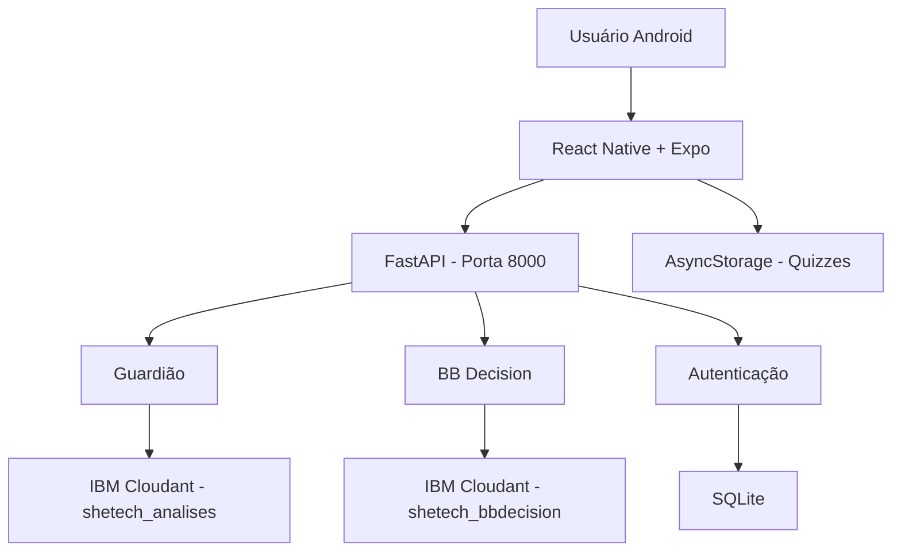

<div align="center">

# 💙 SheTech 💛

### Inteligência que protege. Tecnologia que transforma.

**GUARDIÃO + BB DECISION**

Soluções com Inteligência Artificial para promover segurança digital, educação financeira e decisões mais conscientes.

**Projeto IBM × Banco do Brasil | Serviços Financeiros**

<br>


<br>

**[Como executar](#-como-executar-o-projeto) • [Sobre](#-sobre-o-projeto) • [Soluções](#-nossas-soluções) • [Tecnologias](#-tecnologias-utilizadas) • [Equipe](#-conheça-a-shetech)**

</div>

---

> [!IMPORTANT]
> ### 📱 Execução do SheTech Mobile
>
> O SheTech Mobile utiliza **React Native com Expo** e um backend desenvolvido em **Python com FastAPI**.
>
> O procedimento de execução documentado utiliza um celular Android conectado ao computador por USB, com o aplicativo Expo Go.
>
> A comunicação entre o aplicativo e o backend é realizada por meio do **ADB reverse**, que redireciona as portas utilizadas durante os testes locais.
>
> Para executar o aplicativo, siga as instruções abaixo.

---

## 💻 Como executar o projeto

### 📋 Pré-requisitos

| Ferramenta | Descrição |
|---|---|
| Windows | Ambiente com PowerShell |
| Visual Studio Code | Ambiente de desenvolvimento |
| Python | Versão 3.11 |
| Node.js e npm | Execução do aplicativo Expo |
| Android SDK Platform-Tools | Ferramentas ADB |
| Expo Go | Aplicativo instalado no Android |
| Cabo USB | Cabo de dados para conectar o celular |
| Git | Clonagem do repositório |

Também é necessário ativar a **Depuração USB** no celular Android.

### 1. Clone o repositório

Abra o terminal e execute:

```bash
git clone https://github.com/GiovannaMontoro/IBM-MOBILE-shetech.git
```

Entre na pasta do projeto:

```bash
cd IBM-MOBILE-shetech
```

O projeto deve estar disponível em uma pasta do seu computador.

> **Atenção:** os caminhos apresentados neste guia devem ser adaptados ao local em que você salvou o projeto.

### 2. Configure o ambiente

O backend utiliza um arquivo de configuração local:

```text
backend/.env
```

Utilize o arquivo `.env.example` como referência para configurar as variáveis necessárias.

As credenciais e chaves de API devem permanecer protegidas.

> [!CAUTION]
> Nunca compartilhe arquivos `.env`, chaves de API, senhas ou tokens de autenticação em repositórios públicos.

### 3. Conecte o celular Android

Ative as **Opções do desenvolvedor** e a **Depuração USB** no seu dispositivo.

Conecte o celular ao computador com um cabo USB de dados e aceite a autorização de depuração exibida na tela.

No PowerShell, execute:

```powershell
$adbExe = "$env:LOCALAPPDATA\Android\Sdk\platform-tools\adb.exe"

& $adbExe devices
```

O dispositivo deverá aparecer com o estado:

```text
device
```

Caso apareça `unauthorized`, desbloqueie o celular e autorize a conexão.

### 4. Redirecione as portas

Execute:

```powershell
& $adbExe reverse tcp:8081 tcp:8081

& $adbExe reverse tcp:8000 tcp:8000
```

| Porta | Finalidade |
|---|---|
| `8081` | Servidor Expo/Metro |
| `8000` | Backend FastAPI |

> Se desconectar e reconectar o cabo USB, execute novamente os comandos de redirecionamento.

### 5. Inicie o backend (Terminal 1)

Abra um terminal PowerShell.

Defina o caminho da pasta principal do projeto:

```powershell
$projectPath = "C:\CAMINHO\PARA\IBM-MOBILE-shetech"
```

Substitua o caminho pelo local real no seu computador.

Acesse a pasta backend:

```powershell
cd (Join-Path $projectPath "backend")
```

Configure a codificação:

```powershell
$env:PYTHONUTF8 = "1"

$env:PYTHONIOENCODING = "utf-8"
```

Execute:

```powershell
.\start.ps1
```

O backend deverá iniciar na porta `8000`.

✅ API local:

http://localhost:8000

✅ Documentação interativa:

http://localhost:8000/docs

**Mantenha esse terminal aberto.**

### 6. Inicie o aplicativo Expo (Terminal 2)

Abra outro PowerShell.

Acesse a pasta principal do projeto:

```powershell
$projectPath = "C:\CAMINHO\PARA\IBM-MOBILE-shetech"

cd $projectPath
```

Execute:

```powershell
npx expo start --go --localhost --port 8081 --clear
```

O servidor Expo/Metro será iniciado.

Abra o aplicativo pelo **Expo Go** no celular Android conectado, seguindo as opções exibidas no terminal.

> O modo `--localhost` funciona neste procedimento porque o ADB reverse encaminha a porta `8081` para o dispositivo.

### 7. Teste o aplicativo

Com o backend e o Expo funcionando:

1. Entre com uma conta de teste válida.
2. Acesse o Guardião.
3. Envie uma mensagem fictícia para análise.
4. Confira a pontuação, os sinais identificados e as recomendações.
5. Teste o envio de imagem ou áudio conforme os formatos aceitos.
6. Acesse o BB Decision e execute uma simulação.
7. Se necessário, confira os eventos registrados no IBM Cloudant.

✅ O aplicativo estará preparado para os testes locais documentados.

---

## 👩‍💻 Conheça a SheTech

<div align="center">

### Três mulheres. Duas soluções. Um propósito.

A **SheTech** é formada por três integrantes que compartilham o interesse por tecnologia, inovação e criação de soluções com impacto positivo.

Nosso trabalho une criatividade, desenvolvimento de software, Inteligência Artificial e experiência do usuário.

<br>

<table>
<tr>

<td align="center" width="200">

<a href="https://github.com/GiovannaMontoro">

<br>
<strong>Giovanna Montoro</strong>
</a>

<br>

<sub>@GiovannaMontoro</sub>

</td>

<td align="center" width="200">

<a href="https://github.com/marianoronha">

<br>
<strong>Maria Noronha</strong>
</a>

<br>

<sub>@marianoronha</sub>

</td>

<td align="center" width="200">

<a href="https://github.com/LaraAntuness">

<br>
<strong>Lara Antunes</strong>
</a>

<br>

<sub>@LaraAntuness</sub>

</td>

</tr>
</table>

<br>

**Clique nas fotos para conhecer os perfis de cada integrante no GitHub.**

*Tecnologia, colaboração e inovação para transformar ideias em soluções.*

</div>

---

## 🌍 Impacto esperado

Com o Guardião e o BB Decision, buscamos:

- 🛡️ Ampliar a conscientização sobre golpes digitais.
- 💬 Facilitar o acesso a informações de segurança.
- 🎮 Transformar aprendizado em experiências práticas.
- 📊 Incentivar decisões financeiras mais conscientes.
- 💙 Promover uma experiência digital mais acessível.
- 🚀 Explorar o potencial da IA aplicada a desafios reais.

---

## ✨ Sobre o projeto

E se a Inteligência Artificial pudesse ajudar você a identificar golpes antes de cair neles e compreender os impactos das suas decisões financeiras antes de tomá-las?

Foi a partir dessa ideia que nasceu o nosso projeto.

Desenvolvido pela equipe **SheTech**, no contexto do projeto IBM × Banco do Brasil, o sistema reúne duas soluções que compartilham um propósito: tornar a experiência financeira mais segura, inteligente e acessível.

A versão mobile utiliza **React Native e Expo**, permitindo utilizar as funcionalidades do projeto diretamente em um dispositivo Android durante os testes.

Mais do que utilizar Inteligência Artificial, buscamos desenvolver experiências que considerem o contexto, a necessidade e a realidade de cada usuário.

> **Nossa missão:** transformar tecnologia em autonomia, proteção e conhecimento.

---

## 🎯 O problema

O cotidiano financeiro envolve decisões que podem afetar diretamente a segurança e o bem-estar das pessoas.

Identificamos dois desafios principais:

<table>
<tr>

<td width="50%" valign="top">

<h3>🛡️ Golpes digitais</h3>

<p>Golpes de engenharia social utilizam mensagens falsas, senso de urgência e manipulação emocional para induzir vítimas a compartilhar informações ou transferir dinheiro.</p>

<p>A simples identificação de palavras suspeitas nem sempre é suficiente para compreender uma tentativa de fraude.</p>

<p><strong>Nosso desafio:</strong> identificar sinais de risco e orientar o usuário antes que ele seja prejudicado.</p>

</td>

<td width="50%" valign="top">

<h3>📊 Decisões financeiras</h3>

<p>Compras parceladas, mudanças de renda e outros compromissos financeiros podem gerar consequências difíceis de prever.</p>

<p>Muitas pessoas tomam decisões sem conseguir visualizar claramente seus possíveis impactos.</p>

<p><strong>Nosso desafio:</strong> oferecer ferramentas que tornem o planejamento mais acessível e compreensível.</p>

</td>

</tr>
</table>

---

## 🚀 Nossas soluções

<div align="center">

### 🛡️ Guardião + 📊 BB Decision

**Duas soluções que unem segurança digital e educação financeira.**

</div>

---

# 🛡️ Guardião

### Proteção que vai além de um alerta.

O **Guardião** analisa conteúdos suspeitos, identifica sinais de fraude e apresenta explicações claras para o usuário.

A proposta considera não apenas palavras isoladas, mas também o contexto e a intenção por trás das mensagens.

### 🔍 Principais funcionalidades

| Funcionalidade | Descrição |
|---|---|
| 🔎 Análise de mensagens | Identificação de indícios de golpes e engenharia social |
| 📎 Envio de imagens | Análise de imagens enviadas pelo usuário |
| 🎙️ Envio de áudio | Análise de arquivos de áudio |
| 📊 Indicador de risco | Apresentação da pontuação estimada de risco |
| 💡 Sinais identificados | Informações sobre os indícios encontrados na análise |
| 🛡️ Recomendações | Orientações para prevenção e proteção |

### ⚙️ Como funciona?

O usuário interage com o aplicativo mobile e envia uma mensagem ou arquivo para análise.

O aplicativo encaminha a solicitação ao backend FastAPI.

O backend realiza o processamento e retorna o resultado para o celular.

**Entrada do usuário → Backend → Análise → Avaliação de risco → Resultado e recomendações**

### 🎮 Aprendizado na prática

O projeto também contempla experiências educativas relacionadas à identificação de golpes.

Os dados locais dos quizzes são armazenados no dispositivo utilizando **AsyncStorage**, conforme a configuração documentada.

Dessa forma, a proposta do Guardião inclui conscientização e autonomia digital.

> Uma pontuação de risco não representa prova definitiva de fraude. As análises devem ser interpretadas como orientações e não como garantia de segurança.

---

# 📊 BB Decision

### O futuro das suas decisões começa com uma pergunta.

O **BB Decision** parte de uma pergunta simples:

### "E se eu fizer isso?"

A solução apresenta simulações de cenários financeiros para auxiliar na compreensão dos impactos de diferentes escolhas.

### 💡 Exemplos de utilização

| Pergunta | O que pode ser analisado |
|---|---|
| 🛍️ E se eu parcelar uma compra? | Impacto das parcelas no orçamento |
| 💰 E se minha renda diminuir? | Possíveis efeitos sobre despesas e reserva |
| 🏠 E se eu comprar uma casa? | Comprometimento da renda e metas |
| 🎯 E se eu quiser economizar mais? | Alternativas de planejamento |
| 💼 E se eu mudar de emprego? | Mudanças no cenário financeiro |

### ⚙️ Como funciona?

No aplicativo mobile, o usuário realiza uma simulação de teste.

O aplicativo envia a solicitação ao backend, que processa a simulação e devolve o resultado.

Quando a integração com o IBM Cloudant está habilitada e configurada corretamente, o backend também registra eventos relacionados às simulações.

**Pergunta → Backend → Simulação → Resultado apresentado no aplicativo**

### 🌟 Nosso diferencial

O BB Decision busca transformar informações financeiras em explicações acessíveis, permitindo que o usuário compreenda melhor suas escolhas.

> As simulações são estimativas para fins informativos e demonstrativos. Não representam garantias de resultados futuros nem recomendações de investimento.

---

## 🧠 Inteligência Artificial

A proposta do projeto utiliza Inteligência Artificial para apoiar a análise de conteúdos suspeitos e a compreensão de cenários financeiros.

Na versão mobile, o aplicativo se comunica com o backend FastAPI, responsável pelo processamento das solicitações.

O manual de execução documenta a utilização de serviços externos configurados no ambiente, além da integração com o IBM Cloudant para registro de eventos.

---

## 🛠️ Tecnologias utilizadas

<div align="center">


</div>

| Tecnologia | Utilização |
|---|---|
| React Native | Desenvolvimento do aplicativo mobile |
| Expo | Execução do aplicativo |
| Expo Go | Testes no dispositivo Android |
| Node.js e npm | Dependências e ferramentas do aplicativo |
| Python 3.11 | Ambiente de execução do backend |
| FastAPI | API do projeto |
| IBM Cloudant | Registro de eventos de análises e simulações |
| SQLite | Cadastro, login e dados de usuários |
| JWT | Autenticação |
| AsyncStorage | Armazenamento local de informações dos quizzes |
| Android SDK / ADB | Comunicação com o Android durante os testes |
| PowerShell | Inicialização e configuração do ambiente no Windows |

---

## 🏗️ Arquitetura do sistema

A aplicação utiliza componentes com responsabilidades distintas.



### 📦 Persistência de dados

O SheTech Mobile utiliza persistência híbrida, com diferentes tecnologias responsáveis por partes específicas do sistema.

| Tecnologia | Identificador | Finalidade |
|---|---|---|
| IBM Cloudant | `shetech_analises` | Eventos das análises do Guardião |
| IBM Cloudant | `shetech_bbdecision` | Eventos das simulações do BB Decision |
| SQLite | `backend/shetech.db` | Cadastro, login e autenticação |
| AsyncStorage | Dispositivo Android | Informações locais dos quizzes |

### ☁️ IBM Cloudant

O IBM Cloudant é utilizado para registrar eventos relacionados às análises do Guardião e às simulações do BB Decision.

A gravação depende da integração habilitada e de credenciais válidas.

A configuração documentada utiliza:

```env
CLOUDANT_ENABLED=true
CLOUDANT_URL=https://<instancia-cloudant>
CLOUDANT_APIKEY=<chave-de-api-autorizada>
CLOUDANT_DB=shetech_analises
CLOUDANT_DB_BBDECISION=shetech_bbdecision
```

Os valores de URL e chave de API acima são apenas ilustrativos.

**As credenciais reais devem permanecer no arquivo local `backend/.env`.**

### 🔐 SQLite e autenticação

O SQLite é utilizado para armazenar os dados relacionados ao cadastro e à autenticação dos usuários.

O backend utiliza integração com JWT.

Nesta configuração, os dados de autenticação permanecem no SQLite e não são automaticamente migrados para o IBM Cloudant.

### 📱 AsyncStorage

O AsyncStorage é utilizado para informações locais dos quizzes no dispositivo Android.

Os dados não são sincronizados com o IBM Cloudant nesta configuração.

---

## 🧪 Testes do aplicativo

### 🛡️ Guardião

Com o backend e o Expo ativos:

1. Acesse a aplicação no Android.
2. Entre com uma conta de teste.
3. Abra o Guardião.
4. Envie uma mensagem fictícia.
5. Verifique a pontuação de risco.
6. Confira os sinais identificados.
7. Observe as recomendações.
8. Teste imagens e áudios conforme os formatos aceitos.

### 📊 BB Decision

1. Abra o BB Decision.
2. Execute uma simulação de teste.
3. Confira o resultado apresentado.
4. Se necessário, verifique o evento correspondente no IBM Cloudant.

### ☁️ Verificação do Cloudant

Com a integração configurada:

1. Execute uma análise fictícia no Guardião.
2. Realize uma simulação no BB Decision.
3. Acesse o IBM Cloudant utilizando uma conta autorizada.
4. Abra o banco `shetech_analises`.
5. Abra o banco `shetech_bbdecision`.
6. Atualize a listagem de documentos.
7. Verifique se novos eventos foram registrados.

> A exibição do resultado no aplicativo e a gravação do evento no Cloudant devem ser verificadas separadamente.

---

## 🛠️ Solução de problemas

### O ADB não é reconhecido

Utilize o caminho completo do executável:

```powershell
$adbExe = "$env:LOCALAPPDATA\Android\Sdk\platform-tools\adb.exe"
```

Confira se o Android SDK Platform-Tools está instalado.

### O dispositivo não aparece

Execute:

```powershell
& $adbExe devices
```

Confira o cabo USB, a autorização de depuração e a conexão do dispositivo.

Depois, refaça os comandos `adb reverse`.

### Erro: package.json não existe

Verifique se o Expo foi iniciado na pasta principal do projeto.

Não execute o comando do Expo dentro da pasta `backend`.

### Porta 8000 ou 8081 ocupada

Execute:

```powershell
Get-NetTCPConnection -LocalPort 8000,8081 -State Listen -ErrorAction SilentlyContinue |
 Select-Object LocalAddress,LocalPort,OwningProcess
```

Identifique o processo antes de encerrá-lo.

### Erro de codificação Unicode

No terminal do backend:

```powershell
$env:PYTHONUTF8 = "1"
$env:PYTHONIOENCODING = "utf-8"
```

Reinicie o script de inicialização.

### O aplicativo abre, mas a análise não funciona

Confira:

- Se o backend FastAPI está ativo.
- Se a porta `8000` foi redirecionada pelo ADB.
- Se o aplicativo aponta para a API correta.
- Se as credenciais externas estão configuradas corretamente.
- Se existem erros nos logs do backend.

---

## 🔒 Segurança e IA responsável

### Cuidados de segurança

- 🔐 Mantenha credenciais fora dos arquivos versionados.
- 🛡️ Não compartilhe chaves de API ou tokens JWT.
- 📁 Proteja o arquivo `backend/.env`.
- 🧪 Utilize dados fictícios durante os testes.
- ☁️ Configure permissões adequadas para acessar o IBM Cloudant.
- 🔒 Em ambientes publicados, utilize HTTPS e controle o acesso à API.

### Privacidade e persistência

Os eventos documentados do Guardião são estruturados para armazenar metadados das análises, sem persistir o conteúdo integral das mensagens nesses eventos.

Os registros podem incluir identificador, data e hora, canal utilizado, pontuação de risco e indicadores relacionados à análise.

Os eventos do BB Decision podem incluir informações do tipo de cenário, data e hora e outros metadados da simulação.

Os campos efetivamente presentes podem variar conforme a operação e a versão do backend.

### Limitações

- A classificação de risco não garante a identificação de todos os golpes.
- Os resultados de IA podem exigir verificação.
- As simulações financeiras não garantem resultados futuros.
- O procedimento descrito é voltado aos testes locais.
- A distribuição independente exige a preparação de uma build e a publicação de uma API protegida por HTTPS.

---

## 📁 Estrutura e organização

O manual identifica os seguintes arquivos e recursos utilizados na execução:

| Arquivo ou recurso | Finalidade |
|---|---|
| `README.md` | Documentação do projeto |
| `backend/` | Backend da aplicação |
| `backend/start.ps1` | Inicialização do backend |
| `backend/.env` | Configurações locais |
| `.env.example` | Referência das variáveis de ambiente |
| `backend/shetech.db` | Banco SQLite |
| `package.json` | Configuração das dependências do aplicativo |

O servidor Expo é iniciado na pasta principal do projeto, enquanto o backend é executado separadamente.

---

## ⚖️ Aviso legal

Este projeto é um protótipo funcional de caráter demonstrativo, desenvolvido para fins de estudo no contexto do projeto IBM × Banco do Brasil.

As soluções não devem ser interpretadas como serviços bancários oficiais em produção.

Os resultados de análises e simulações possuem finalidade informativa e educativa.

---

<div align="center">

### 💙 Tecnologia com propósito. Inovação com impacto. 💛

**SheTech | Guardião + BB Decision**

*Protegendo escolhas. Transformando futuros.*

<br>

**Desenvolvido pela equipe SheTech**

</div>
