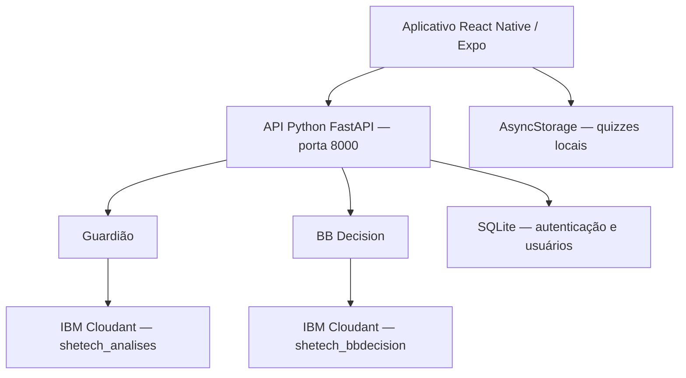

💙 SheTech Mobile 💛
Inteligência que protege. Tecnologia que transforma.
GUARDIÃO + BB DECISION

Soluções com Inteligência Artificial para promover segurança digital, educação financeira e decisões mais conscientes.

Projeto IBM × Banco do Brasil | Serviços Financeiros

Como executar • Sobre • Soluções • Tecnologias • Equipe

📱 Como executar o projeto
Este guia descreve a execução local do SheTech Mobile em Windows, com um celular Android conectado via USB. O aplicativo utiliza React Native/Expo e um servidor Python FastAPI. Durante os testes, o aplicativo é aberto pelo Expo Go, e o acesso ao backend do computador é feito por redirecionamento de portas com ADB.
Pré-requisitos
- Windows com PowerShell e Visual Studio Code.
- Python 3.11 e dependências do backend instaladas pelo script start.ps1.
- Node.js e npm; dependências do projeto instaladas (npm ci, quando necessário).
- Android SDK Platform-Tools (ADB), cabo USB de dados e depuração USB ativada no Android.
- Aplicativo Expo Go instalado no Android.
- Acesso à internet para os serviços externos configurados.
- Arquivo backend/.env configurado localmente.
1. Acesse o repositório
git clone https://github.com/GiovannaMontoro/IBM-MOBILE-shetech.git
cd IBM-MOBILE-shetech
Os comandos seguintes devem ser executados na pasta em que o projeto estiver salvo no seu próprio computador.
2. Conecte o celular por USB
Ative as Opções do desenvolvedor e a Depuração USB no Android. Conecte o aparelho ao computador e aceite a autorização de depuração no celular.

No PowerShell, utilize o caminho do ADB (o SDK também pode estar instalado em outro local):
$adbExe = "$env:LOCALAPPDATA\Android\Sdk\platform-tools\adb.exe"
& $adbExe devices
O dispositivo deve aparecer com o estado device. Se aparecer unauthorized, desbloqueie o celular e autorize a conexão.

Redirecione as portas:
& $adbExe reverse tcp:8081 tcp:8081
& $adbExe reverse tcp:8000 tcp:8000
- 8081: servidor de desenvolvimento Expo/Metro.
- 8000: API FastAPI.
Repita esses comandos se desconectar e reconectar o cabo.
3. Inicie o backend — Terminal 1
No PowerShell, substitua o caminho de exemplo pelo local real da pasta do projeto:
$projectPath = "C:\CAMINHO\PARA\IBM-MOBILE-shetech"
cd (Join-Path $projectPath "backend")
$env:PYTHONUTF8 = "1"
$env:PYTHONIOENCODING = "utf-8"
.\start.ps1
O servidor deve informar que está ouvindo em http://0.0.0.0:8000. Mantenha o terminal aberto.

Para consultar a documentação interativa da API, quando habilitada, abra:

http://localhost:8000/docs
4. Inicie o aplicativo Expo — Terminal 2
Abra outro terminal PowerShell, agora na pasta principal do projeto:
$projectPath = "C:\CAMINHO\PARA\IBM-MOBILE-shetech"
cd $projectPath
npx expo start --go --localhost --port 8081 --clear
Após o Metro iniciar, abra o projeto no Expo Go no Android conectado. O modo --localhost funciona neste procedimento porque o adb reverse encaminha a porta 8081.
5. Teste o aplicativo
- Entre com uma conta de teste válida na tela de login.
- No Guardião, envie uma mensagem fictícia e confira pontuação, sinais identificados e recomendações.
- Teste o envio de imagem ou áudio conforme os formatos aceitos pelo aplicativo.
- No BB Decision, execute uma simulação e verifique o resultado.
- Se necessário, confira os eventos nos bancos do IBM Cloudant configurados para Guardião e BB Decision.
A pontuação de risco não é prova definitiva de fraude. Utilize dados fictícios, sem informações pessoais reais, nos testes.

6. Encerramento
Use Ctrl+C nos terminais do backend e do Expo. Para executar novamente, conecte o Android, confirme adb devices, refaça os comandos adb reverse e inicie os dois serviços.
👩‍💻 Conheça a SheTech

Três mulheres. Duas soluções. Um propósito.
A SheTech é formada por três integrantes que compartilham o interesse por tecnologia, inovação e criação de soluções com impacto positivo.

Nosso trabalho une criatividade, desenvolvimento de software, Inteligência Artificial e experiência do usuário.

<table>
<tr>
<td align="center" width="200">
<a href="https://github.com/GiovannaMontoro">
 
<strong>Giovanna Montoro</strong>
</a> 
@GiovannaMontoro
</td>
<td align="center" width="200">
<a href="https://github.com/marianoronha">
 
<strong>Maria Noronha</strong>
</a> 
@marianoronha
</td>
<td align="center" width="200">
<a href="https://github.com/LaraAntuness">
 
<strong>Lara Antunes</strong>
</a> 
@LaraAntuness
</td>
</tr>
</table>
Clique nas fotos para conhecer os perfis de cada integrante no GitHub.

Tecnologia, colaboração e inovação para transformar ideias em soluções.

🌍 Impacto esperado
Com o Guardião e o BB Decision, buscamos:
- 🛡️ Ampliar a conscientização sobre golpes digitais.
- 💬 Facilitar o acesso a informações de segurança.
- 🎮 Transformar aprendizado em experiências práticas.
- 📊 Incentivar decisões financeiras mais conscientes.
- 💙 Promover uma experiência digital mais acessível.
- 🚀 Explorar o potencial da IA aplicada a desafios reais.
✨ Sobre o projeto
E se a Inteligência Artificial pudesse ajudar você a identificar golpes antes de cair neles e compreender os impactos das suas decisões financeiras antes de tomá-las?

Foi a partir dessa ideia que nasceu o nosso projeto.

Desenvolvido pela equipe SheTech, no contexto do projeto IBM × Banco do Brasil, o sistema reúne duas soluções que compartilham um propósito: tornar a experiência financeira mais segura, inteligente e acessível.

Mais do que utilizar Inteligência Artificial, buscamos desenvolver experiências que considerem o contexto, a necessidade e a realidade de cada usuário.
Nossa missão: transformar tecnologia em autonomia, proteção e conhecimento.

🎯 O problema
O cotidiano financeiro envolve decisões que podem afetar diretamente a segurança e o bem-estar das pessoas.

Identificamos dois desafios principais:
🛡️ Golpes digitais	📊 Decisões financeiras
Golpes de engenharia social utilizam mensagens falsas, senso de urgência e manipulação emocional para induzir vítimas a compartilhar informações ou transferir dinheiro. A identificação de palavras suspeitas nem sempre é suficiente para compreender uma tentativa de fraude.	Compras parceladas, mudanças de renda e outros compromissos financeiros podem gerar consequências difíceis de prever. Muitas pessoas tomam decisões sem visualizar claramente seus possíveis impactos.
Desafio: identificar sinais de risco e orientar o usuário antes que seja prejudicado.	Desafio: oferecer ferramentas que tornem o planejamento mais acessível e compreensível.

🚀 Nossas soluções
🛡️ Guardião — Sua segurança em primeiro lugar
O Guardião analisa conteúdos suspeitos, identifica sinais de fraude e apresenta explicações claras. Sua proposta considera o contexto e a intenção por trás das mensagens, além de palavras isoladas.
Funcionalidade	Descrição
🔎 Análise de mensagens	Identificação de indícios de golpes e engenharia social.
📎 Envio de imagem ou áudio	Testes com arquivos nos formatos aceitos pelo aplicativo.
📊 Indicador de risco	Pontuação e sinais identificados na análise.
🛡️ Recomendações	Orientações apresentadas após a análise.

Fluxo descrito no manual mobile: aplicativo Expo/React Native → requisição à API FastAPI → processamento no backend → retorno do resultado ao aplicativo → registro de evento no Cloudant quando a integração está habilitada e configurada.
📊 BB Decision — Suas escolhas, seu futuro
O BB Decision é um simulador financeiro pensado para explorar possibilidades e compreender os impactos de diferentes decisões.
Exemplos apresentados no README web
Pergunta	O que pode ser analisado
🛍️ E se eu parcelar uma compra?	Impacto das parcelas no orçamento.
💰 E se minha renda diminuir?	Possíveis efeitos sobre despesas e reserva.
🏠 E se eu comprar uma casa?	Comprometimento da renda e metas.
🎯 E se eu quiser economizar mais?	Alternativas de planejamento.
💼 E se eu mudar de emprego?	Mudanças no cenário financeiro.

No aplicativo mobile, o manual orienta executar uma simulação e verificar o resultado. Quando configurada, a integração com Cloudant registra eventos dessas simulações.
As simulações são estimativas para fins informativos e demonstrativos. Não representam garantias de resultados futuros nem recomendações de investimento.

🛠️ Tecnologias utilizadas
Tecnologia	Utilização documentada na versão mobile
React Native / Expo	Aplicativo mobile.
Expo Go	Execução do aplicativo em Android nos testes locais.
Node.js / npm	Dependências e ferramentas do projeto Expo.
Python 3.11 / FastAPI	Backend e API.
ADB (Android Debug Bridge)	Comunicação via USB e redirecionamento de portas.
IBM Cloudant	Eventos de análises e simulações, quando configurado.
SQLite	Cadastro, login e autenticação de usuários com JWT.
AsyncStorage	Dados locais dos quizzes no aparelho Android.

🏗️ Arquitetura e persistência de dados
O projeto utiliza persistência híbrida: Cloudant para eventos, SQLite para autenticação e dados de usuários e AsyncStorage para os quizzes locais.

Durante os testes via USB, a comunicação entre o celular e o backend no computador usa adb reverse.
Recurso	Identificador	Finalidade
IBM Cloudant	shetech_analises	Eventos das análises do Guardião (texto, imagem e áudio).
IBM Cloudant	shetech_bbdecision	Eventos das simulações do BB Decision.
SQLite	backend/shetech.db	Cadastro, login e autenticação de usuários; integração com JWT.
AsyncStorage	Dispositivo Android	Dados locais de quizzes, não sincronizados com Cloudant nesta configuração.

Configuração do IBM Cloudant
O manual orienta configurar, no arquivo local backend/.env, os parâmetros abaixo com credenciais autorizadas:
CLOUDANT_ENABLED=true
CLOUDANT_URL=https://<instancia-cloudant>
CLOUDANT_APIKEY=<chave-de-api-autorizada>
CLOUDANT_DB=shetech_analises
CLOUDANT_DB_BBDECISION=shetech_bbdecision
A instância e os bancos precisam existir e a identidade da API deve ter as permissões necessárias. Não versione o .env com credenciais reais.
Eventos registrados
- Guardião: identificador, data/hora UTC, canal (text, image, audio), perfil de linguagem, rótulo e pontuação de risco, indicadores de intervenção/revisão e origem. Os eventos foram desenhados para registrar metadados, sem armazenar o conteúdo integral das mensagens.
- BB Decision: identificador, data/hora UTC, tipo de cenário, perfil de linguagem, necessidade de esclarecimento, presença/quantidade de avisos, identificador SQLite do usuário quando disponível e origem bbdecision-v1.
Os campos efetivos podem variar conforme a versão do backend e a operação. A gravação no Cloudant deve ser verificada separadamente da exibição do resultado no celular.
🧪 Testes e solução de problemas
Verificação funcional
Após iniciar backend e Expo:
1. Faça login com uma conta de teste válida.
2. Execute uma análise fictícia de mensagem no Guardião.
3. Teste imagem ou áudio conforme os formatos aceitos.
4. Execute uma simulação no BB Decision.
5. Com acesso autorizado ao IBM Cloudant, confira os registros em shetech_analises e shetech_bbdecision.
Problemas comuns
Situação	Orientação do manual
adb não é reconhecido	Utilize o caminho completo do executável e confira a instalação do Android SDK Platform-Tools.
Celular não aparece em adb devices	Verifique cabo, USB, autorização da depuração e repita os comandos reverse.
package.json não existe	Execute o Expo na pasta principal, não em backend/.
Porta 8000 ou 8081 ocupada	Identifique o processo antes de encerrá-lo.
Erro Unicode / charmap	Configure PYTHONUTF8 e PYTHONIOENCODING como mostrado no passo do backend.
Aplicativo abre, mas a análise falha	Confira backend, porta 8000 redirecionada, endereço da API e credenciais externas do .env.

Para identificar os processos que utilizam as portas, use:
Get-NetTCPConnection -LocalPort 8000,8081 -State Listen -ErrorAction SilentlyContinue |
  Select-Object LocalAddress,LocalPort,OwningProcess
Não finalize processos desconhecidos.
🔒 Segurança e limitações
- Mantenha backend/.env, chaves de API, senhas e tokens JWT fora do repositório público.
- Utilize o .env.example apenas como referência, sem credenciais reais.
- Utilize dados fictícios nas demonstrações e testes.
- A pontuação de risco do Guardião não garante a identificação de todos os golpes.
- A autenticação permanece no SQLite nesta versão; não há migração automática de usuários para o Cloudant.
- Os dados dos quizzes ficam no AsyncStorage do aparelho e não são sincronizados com o Cloudant nesta configuração.
- A execução descrita aqui é local, pelo Expo Go e USB, não uma distribuição pública de produção.
- Para distribuição independente, o manual indica publicar a API com HTTPS e preparar uma build do aplicativo.
⚖️ Aviso legal
Este projeto é um protótipo funcional de caráter demonstrativo, desenvolvido para fins de estudo no contexto do projeto IBM × Banco do Brasil.

As soluções não devem ser interpretadas como serviços bancários oficiais em produção.

💙 Tecnologia com propósito. Inovação com impacto. 💛
SheTech Mobile | Guardião + BB Decision

Protegendo escolhas. Transformando futuros.

